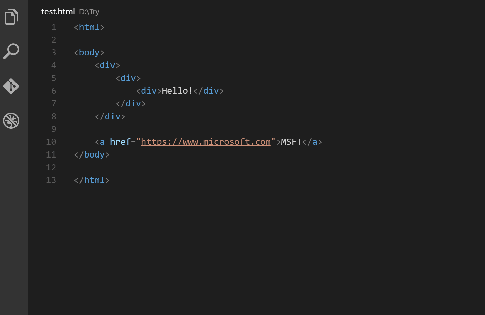

# Auto Rename Tag

Auto Rename Tag renames the paired HTML or XML tag while you type.

Maintained by che-11. Based on [Auto Rename Tag](https://github.com/formulahendry/vscode-auto-rename-tag) by [Jun Han](https://github.com/formulahendry). Tag-matching logic from [Simon Siefke](https://github.com/SimonSiefke)'s rewrite.

## Usage



Type inside an opening or closing tag and the matching tag updates with the same edit, so undo reverts both.

HTML and Handlebars are skipped when `editor.linkedEditing` or `editor.renameOnType` is enabled. VS Code's built-in [auto update tags](https://code.visualstudio.com/docs/languages/html#_auto-update-tags) covers those languages.

## Settings

| Setting | Default | Meaning |
| --- | --- | --- |
| `auto-rename-tag.activationOnLanguage` | `["*"]` | Language ids that activate renaming. `*` means every language. |

```json
{
  "auto-rename-tag.activationOnLanguage": ["html", "xml", "php", "javascript"]
}
```

Use the language id from VS Code, such as `javascript` for `.js` and `javascriptreact` for `.jsx`.

## Development

Open this folder and press F5. `pnpm test` compiles and runs the rename helper tests. `pnpm run package` writes `builds/auto-rename-tag-<version>.vsix`.
