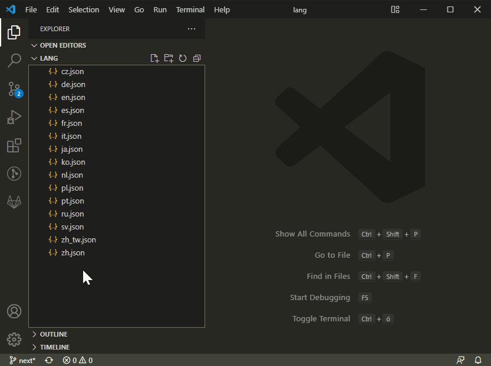

# Batch Rename

Rename several files at once in a text editor, so find/replace and multiple cursors work on the names.

Maintained by che-11. The behavior comes from [batch-rename](https://github.com/JannisX11/batch-rename) by [JannisX11](https://github.com/JannisX11).

## How to use

1. Select files in the Explorer.
2. Right-click a file and choose **Batch Rename**.
3. Edit the names. One line is one file, in the same order.
4. Save to rename. Close the editor to cancel.

If a new name is already taken in that folder, Batch Rename inserts `_1`, `_2`, and so on before the extension. Names that would leave the folder are rejected. A line count that does not match the selection leaves the files untouched.

## Command

| Command | Id |
| --- | --- |
| Batch Rename: Batch Rename | `batch-rename.rename` |

## Development

Open this folder and press F5. `pnpm run package` writes `builds/batch-rename-<version>.vsix`.
