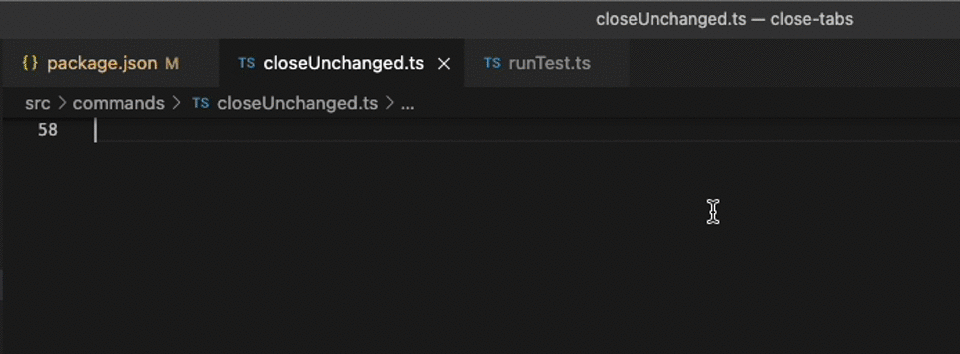

# Close Tabs

Close unchanged tabs, diff editors, tabs to the left, and tabs of one file type.

Maintained by che-11. The behavior comes from [close-tabs](https://github.com/Balastrong/close-tabs) by [Leonardo Montini](https://github.com/Balastrong).

## How to use

Right-click a tab to open the menu.

- **Close Unchanged** closes tabs that are not in the git working tree, and closes diff editors.
- **Close Diff Editors** closes working tree diff tabs.
- **Close to the Left** closes tabs to the left of the active tab.
- **Close all of Type** closes tabs with the same extension as the tab you clicked.
- **Close default Types** closes the extensions listed in settings.

Pinned tabs stay open unless that is allowed in settings. Each command can be hidden from the menu.

## Commands

| Command | Id |
| --- | --- |
| Close Tabs: Close Unchanged | `close-tabs.git-unchanged` |
| Close Tabs: Close Diff Editors | `git.closeAllDiffEditors` |
| Close Tabs: Close to the Left | `close-tabs.close-left` |
| Close Tabs: Close all of Type | `close-tabs.closeAllOfType` |
| Close Tabs: Close default Types | `close-tabs.closeDefaultTypes` |

## Settings

| Setting | Default | Meaning |
| --- | --- | --- |
| `closeTabs.allowClosePinnedTabs` | false | Also close pinned tabs. |
| `closeTabs.showCloseUnchanged` | true | Show Close Unchanged in the tab menu. |
| `closeTabs.showCloseDiffEditors` | true | Show Close Diff Editors in the tab menu. |
| `closeTabs.showCloseToTheLeft` | true | Show Close to the Left in the tab menu. |
| `closeTabs.showCloseType` | true | Show Close all of Type in the tab menu. |
| `closeTabs.closeDefaultTypes` | true | Show Close default Types in the tab menu. |
| `closeTabs.extensionsToClose` | none | Extensions closed by Close default Types. A leading dot is optional. |
| `closeTabs.extensionsCaseSensitive` | false | Match those extensions with case sensitivity. |

## Development

Open this folder and press F5. `pnpm test` compiles and runs the helper tests. `pnpm run package` writes `builds/ce-close-tabs-<version>.vsix`.
