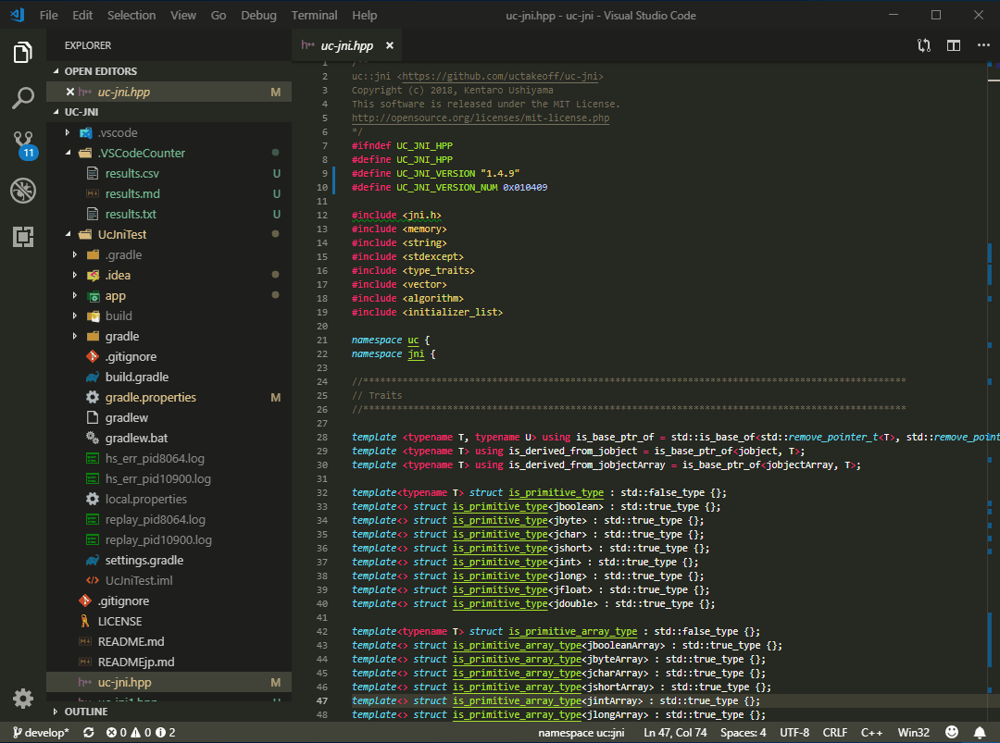
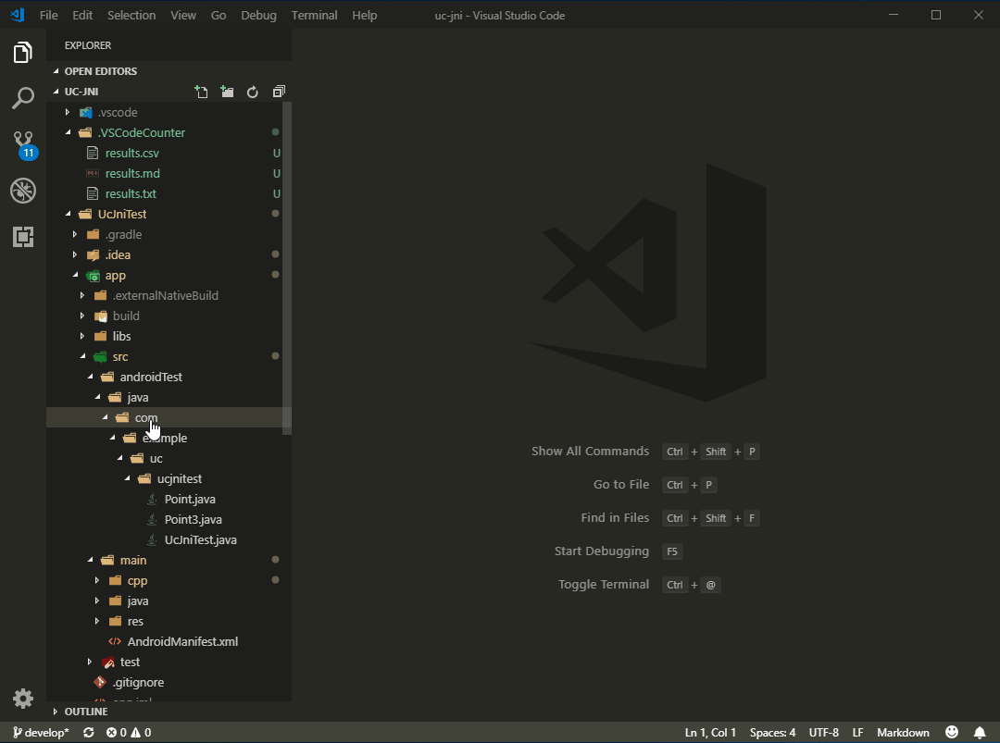
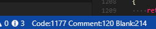
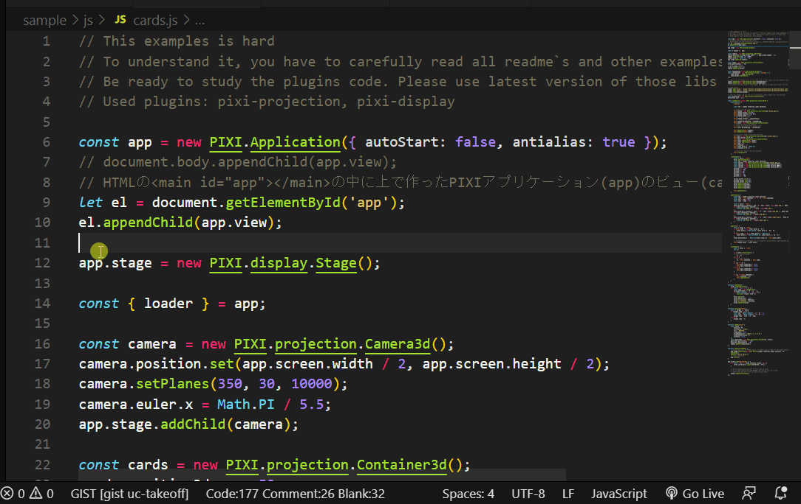
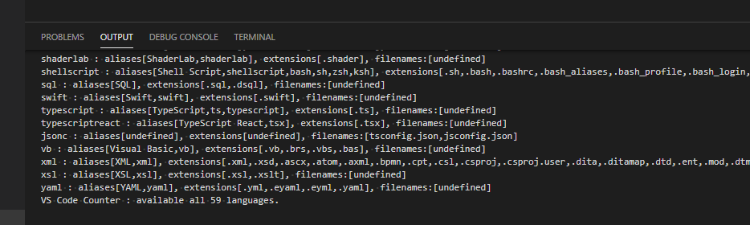
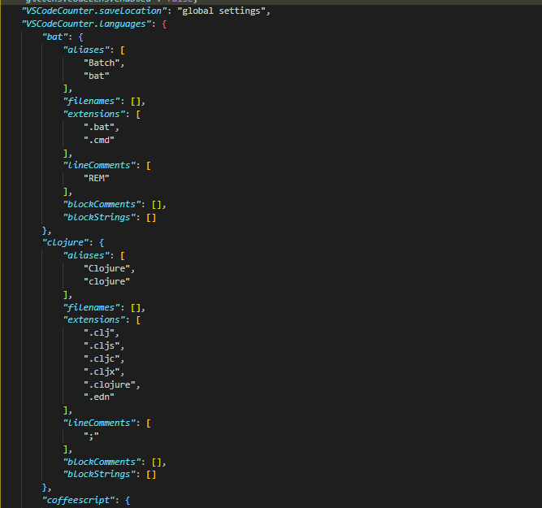

# Code Counter

Code Counter counts blank lines, comment lines, and lines of code. It can count the open file as you type, or a folder or the whole workspace.

Maintained by che-11. Based on [vscode-counter](https://github.com/uctakeoff/vscode-counter) by [Kentaro Ushiyama](https://github.com/uctakeoff).

The counter learns comment syntax from the language extensions you have installed, and from the built-in definitions for common languages.

## Sidebar

The Code Counter icon on the activity bar lists the commands. Click a row to run it.

**Count** counts the workspace, asks for a directory, or turns the real-time status-bar counter on and off. That row shows On or Off. While a workspace or directory count is running, that row shows a spinning icon.

**Languages** lists the languages the counter knows and saves the rules collected from installed extensions.

**Walk** chooses which files a workspace or directory count opens. **File types** limits the walk to extensions such as `.ts` or `.py`. `.ts` also matches `file.d.ts`; exclude `**/*.d.ts` to skip those. All types walks every included file. **Include** and **Exclude** are globs. `.gitignore`, `files.exclude`, and unrecognized languages can be turned on or off from the same list. `+` adds an entry, the pencil edits it, and the trash icon removes it. The next count uses the saved settings.

## Count a workspace or folder

Open the command palette and run **Code Counter: Count Lines in Workspace**.

In the Explorer, right-click a folder and choose **Count Lines in Directory**.

The count opens in an unsaved Markdown preview. Nothing is written into the workspace. Closing the preview discards the result.

## Real-time counter

**Code Counter: Toggle Real-time Counter** shows code, comment, blank, word, and character counts for the active editor on the status bar. A selection counts just that range.

The counter stays on across reloads. Turning it on writes `.code-counter/.code-counter-realtime`, and the extension activates when that file is in the workspace.

## Languages

**Code Counter: Show Available Languages** lists the languages it can count. Installing a language extension adds that language.

**Code Counter: Save Language Configurations** stores the comment rules collected from installed extensions. Remote windows cannot read those extensions, so save the rules locally and take the saved settings or `languages.json` with you.

## Settings

| Setting | Default | Meaning |
| --- | --- | --- |
| `code-counter.fileTypes` | empty | Extensions to walk, such as `.ts`. Empty walks every included file. |
| `code-counter.include` | `**/*` | Files to count. |
| `code-counter.exclude` | `.gitignore`, `.vscode`, `node_modules` | Files to skip. |
| `code-counter.useGitignore` | true | Also skip files ignored by `.gitignore`. |
| `code-counter.useFilesExclude` | true | Also skip files matched by `files.exclude`. |
| `code-counter.ignoreUnsupportedFile` | true | Skip files with no language definition. |
| `code-counter.includeIncompleteLine` | true | Count a last line that has no newline. |
| `code-counter.outputDirectory` | `.code-counter` | Where `languages.json` is written when save location is `output`. |
| `code-counter.saveLocation` | global | Where collected language rules are stored. |

## Development

Open this folder and press F5. `pnpm test` compiles and runs the counter tests. `pnpm run package` writes `builds/ce-code-counter-<version>.vsix`.
