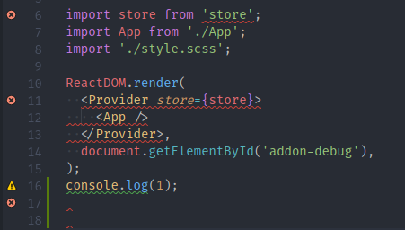

# Error Gutters

Error Gutters puts an icon in the gutter, to the right of the line number, on every line that has a diagnostic.

Maintained by che-11. Based on [Error Gutters](https://github.com/PinkaminaDianePie/error-gutters) by [Igor Sbitnev](https://github.com/PinkaminaDianePie).

## Gutters

It reads the diagnostics API, so it works with any language and any extension that reports problems, such as ESLint. Each line keeps the most severe icon: error, then warning, then info. Hints use the info icon.

## Known issues

The gutter API allows one icon per line. These icons can overlap another extension's gutter icons, or the breakpoint icon.

## Development

Open this folder and press F5. `pnpm run package` writes `builds/ce-error-gutters-<version>.vsix`.
