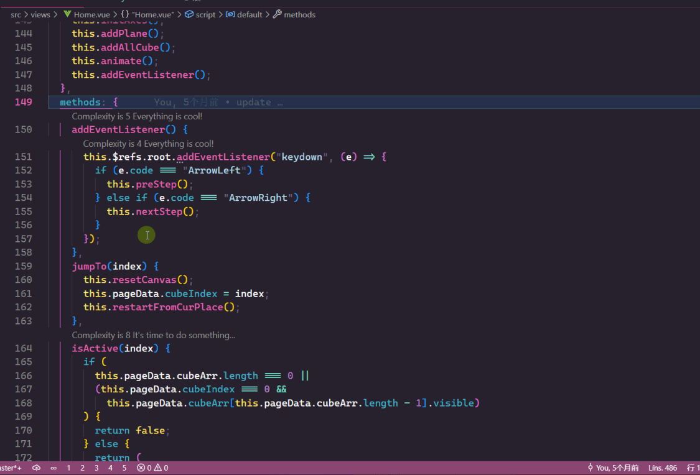
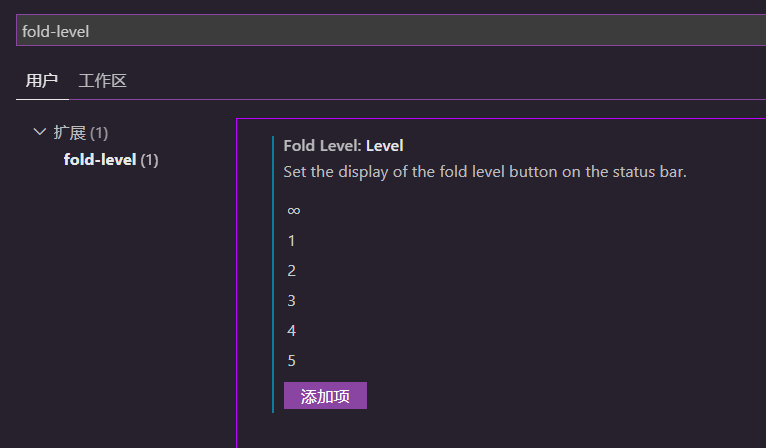
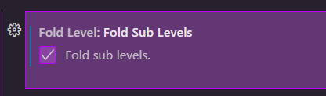

# Fold Level

Fold Level puts fold-depth buttons on the status bar.

Maintained by che-11. The behavior comes from [fold-level](https://github.com/denjay/fold-level) by [denjay](https://github.com/denjay). The original repository declares no license.

## Status bar

Click a number to fold the active editor to that depth. Click ∞ to unfold. The view returns to the line that was in the center, and the cursor stays where it was.

## Commands

| Command | Id |
| --- | --- |
| Fold Level: Unfold All | `fold-level.unfoldAll` |
| Fold Level: Fold Level 1 | `fold-level.foldLevel1` |
| Fold Level: Fold Level 2 | `fold-level.foldLevel2` |
| Fold Level: Fold Level 3 | `fold-level.foldLevel3` |
| Fold Level: Fold Level 4 | `fold-level.foldLevel4` |
| Fold Level: Fold Level 5 | `fold-level.foldLevel5` |
| Fold Level: Fold Level 6 | `fold-level.foldLevel6` |
| Fold Level: Fold Level 7 | `fold-level.foldLevel7` |

## Settings

| Setting | Default | Meaning |
| --- | --- | --- |
| `foldLevel.level` | ∞, 1–7 | Buttons to show. An empty list shows every level. |
| `foldLevel.foldSubLevels` | false | Also fold every deeper level when a level is chosen. |

## Development

Open this folder and press F5. `pnpm test` compiles and runs the fold helper tests. `pnpm run package` writes `builds/fold-level-<version>.vsix`.
