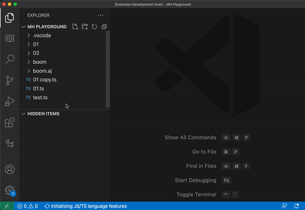
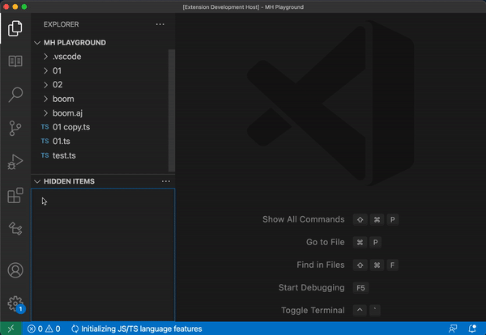
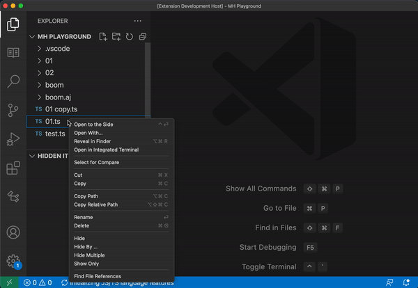
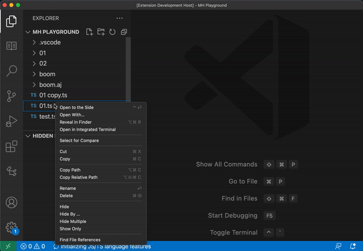
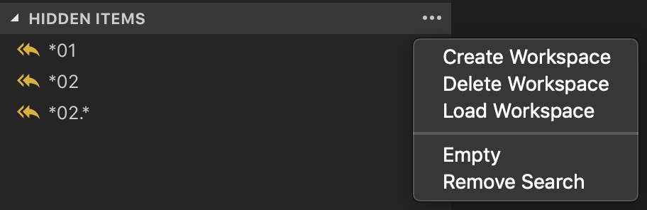

# Make Hidden

Make Hidden adds explorer actions for hiding and showing files and folders. Hidden patterns are the workspace `files.exclude` list, so the explorer, search, and watchers follow them.

Maintained by che-11. Based on [Make Hidden](https://github.com/Devine-Davies/vs-make-hidden) by [Devine-Davies](https://github.com/Devine-Davies) (Red Van Workshop).

## Explorer actions

Right-click a file or folder in the explorer.

- **Hide** excludes that item.
- **Hide Multiple** opens a multi-select list of the items in that directory.
- **Hide By** excludes every match by name or extension. The scope can be the whole workspace, the current directory, the current directory and its children, or child directories only.
- **Show Only** hides the other items in the same directory.

## Hidden Items

The Hidden Items view lists the exclude patterns for this workspace. Select one to put it back. **Remove Search** finds a pattern by name, and **Empty** clears the list. **Undo Last** restores the previous list.

**Workspaces** saves the current list, switches to a saved list, or deletes one.

## Development

Open this folder and press F5. `pnpm run package` writes `builds/ce-make-hidden-<version>.vsix`.

## License

[MIT](LICENSE)
